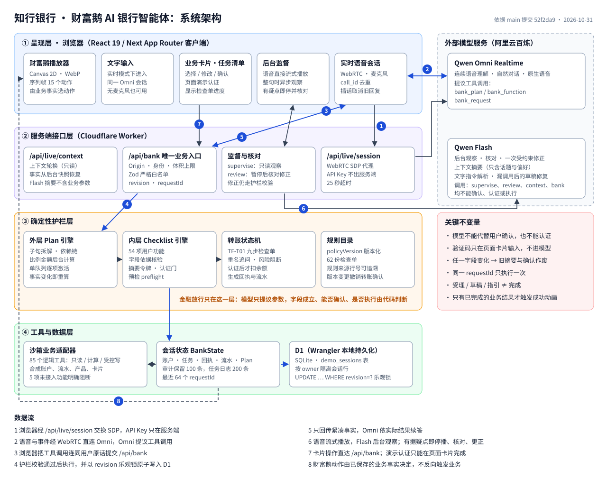
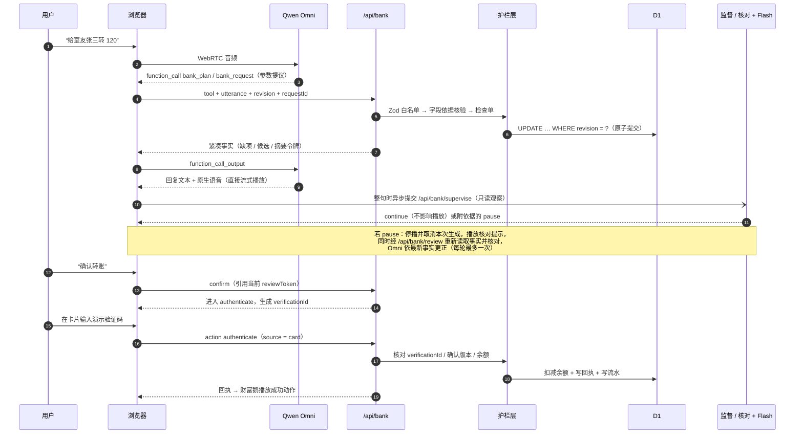

# 系统架构说明

> 适用版本：`voice-bank` 应用，`main` 分支提交 `52f2da9`（2026-10-31）。
> 本文只描述代码中实际存在的结构；所有账户、资金、联系人与产品均为合成沙箱数据，未接入真实银行系统。

## 1. 定位与设计原则

知行银行是面向大学生和初入职场用户的语音银行智能体：用户用自然语音（或文字）说出需求，系统理解意图、拆解多步任务、调用业务工具、引导确认与认证，并解释结果；财富鹅角色根据真实业务状态给出陪伴反馈。

整个系统围绕一条原则设计：**大模型负责听懂和表达，确定性代码负责放行。**

| 原则 | 在架构中的落点 |
|---|---|
| 模型只能提议，不能放行 | 工具参数先过 Zod 白名单，再过字段依据核验、检查单与令牌链；模型无法设置“已通过”标记 |
| 认证与模型隔离 | 验证码只能在页面卡片输入，`authenticate` 操作只接受 `source: 'card'` |
| 边说边监督，有据即停 | 原生语音直接流式播放；Flash 在后台只读观察，发现有具体依据的问题时暂停播放、重新读取后台事实并更正 |
| 状态是唯一事实来源 | 卡片、语音回复、财富鹅动画都读同一份已保存的 `BankState`；动画不能反向触发业务 |
| 每次写入可并发、可重放 | 以 `revision` 乐观锁原子提交，以 `requestId` 去重，重复请求返回原结果 |

## 2. 总体架构



（PNG 版本：[system-architecture.png](system-architecture.png)）

系统分为四层，外加外部模型服务：

| 层 | 主要组件 | 职责 | 不负责 |
|---|---|---|---|
| 呈现层（浏览器） | 实时语音会话、文字输入、业务卡片与任务清单、后台监督、财富鹅播放器 | 采集语音、展示事实、承接确认与页面认证 | 判断业务是否成立 |
| 服务端接口层 | `/api/bank`、`/api/bank/supervise`、`/api/bank/review`、`/api/live/session`、`/api/live/context` | 身份、来源、请求格式与并发控制；代理 SDP；调用观察与核对模型 | 直接调用模型执行业务 |
| 确定性护栏层 | 外层 Plan 引擎、内层 Checklist 引擎、转账状态机、规则目录 | 拆解与依赖、字段依据、确认令牌、认证门、风险阻断 | 自然语言生成 |
| 工具与数据层 | 沙箱业务适配器、`BankState`、D1（SQLite） | 读写合成业务数据、保存回执与审计 | 授权判断 |
| 外部模型 | Qwen Omni Realtime、Qwen Flash（阿里云百炼） | Omni：语音理解与工具提议；Flash：后台观察、核对与受约束修正、上下文摘要、文字指令解析、漏调用后的草稿修复 | 确认、认证、执行 |

## 3. 组件说明

### 3.1 呈现层

| 组件 | 代码 | 说明 |
|---|---|---|
| 主页面 | `app/page.tsx` | 管理语音会话、业务状态、监督与核对流程、卡片渲染 |
| 实时语音 | `lib/voice/live.ts` | WebRTC 传输；先协商、收到 `session.updated` 后才挂载麦克风；无麦克风时仍可文字输入 |
| 会话协议 | `lib/voice/qwen-protocol.ts` | 系统指令、工具定义、事件处理、`call_id` 去重、插话取消、工具调用开始即静音当前回复、工具等待期间不续答 |
| 后台监督 | `lib/voice/background-supervisor.ts`、`correction-cue.ts` | 同一时间只运行一个观察请求，排队只保留最新快照；暂停时播放一次可打断的核对提示录音 |
| 业务卡片 | `components/workflow-panel.tsx`、`plan-panel.tsx`、`serial-stage.tsx` | 收款人选择、字段编辑、摘要确认、演示认证、任务清单 |
| 财富鹅 | `components/wealth-goose.tsx`、`lib/mascot/` | Canvas 2D 播放 WebP 精灵图（512px 单帧、12 FPS、15 个动作）；动作由业务事实映射 |

> 说明：项目文档确定的正式动画路线为 PixiJS + 透明 PNG 序列帧。当前代码使用 Canvas 2D 播放已打包的 WebP 精灵图，`package.json` 中没有 PixiJS 依赖。

### 3.2 服务端接口层

运行在 Cloudflare Worker 兼容运行时（Vinext 构建的 Next App Router），入口 `worker/index.ts`。

| 接口 | 方法 | 作用 |
|---|---|---|
| `/api/bank` | GET | 读取或新建当前用户的演示会话 |
| `/api/bank` | POST | **唯一业务写入口**。每次请求只能携带 `tool`、`action`、`command`、`recovery` 之一 |
| `/api/bank/supervise` | POST | 后台观察：只读后台事实，Flash 只能返回“继续”或“附具体依据的暂停建议”，没有提交业务的入口 |
| `/api/bank/review` | POST | 暂停后的核对：Flash 判定 `accept / repair / reject`，叠加确定性检查，必要时提交一次受约束修正 |
| `/api/live/session` | POST | 代理 WebRTC SDP 交换，API Key 留在服务端 |
| `/api/live/context` | POST | 长会话轮换时生成只读交接上下文 |

`POST /api/bank` 的四种入口：

| 入口 | 来源 | 去向 |
|---|---|---|
| `tool` | Omni 发起的工具调用（`bank_plan` / `bank_function` / `bank_request`），附带用户原话 `utterance` | 经外层 Plan 分派 |
| `action` | 页面卡片操作（选择、编辑、确认、认证、取消、重置） | 同上，`source` 标记为 `card` |
| `command` | 文字指令或离线演示 | 确定性解析；复杂请求进入 Plan |
| `recovery` | 实时对话漏调用或工具报错后的一次草稿修复 | 只能建草稿或查询，不能确认或执行 |

所有入口先经 `dispatchAction` 分派：新业务建立外层 Plan（单项业务也建一项）或插入当前 Plan；对当前任务的补充、确认、认证进入该步骤的内层 Checklist，进入前由 `assertPlanAccess` 检查不能跳过依赖或另起任务，完成后由 `reconcilePlan` 推进下一步。

### 3.3 确定性护栏层

| 模块 | 代码 | 职责 |
|---|---|---|
| 外层 Plan 引擎 | `lib/plans/` | 把一句话拆成最多 6 个业务子句、最多 12 个步骤，建立依赖链；比例金额由后台按实时余额计算；单队列逐项激活 |
| 内层 Checklist 引擎 | `lib/workflows/engine.ts`、`fields.ts`、`adapters.ts` | 57 项用户功能的草稿、缺项、预检、摘要令牌、确认、认证与执行 |
| 转账状态机 | `lib/bank/engine.ts` | `recipient → details → review → authenticate → complete`，执行 TF-T01 九步检查单 |
| 规则目录 | `lib/checklists/` | 62 份业务检查单（269 条规则），带 `policyVersion` 与业务原稿行号 |

### 3.4 工具与数据层

| 组件 | 说明 |
|---|---|
| 用户功能目录 | `lib/workflows/catalog-data.json`：5 个模块共 57 项功能（转账与账户 11、账单 10、订阅与代扣 8、理财与目标储蓄 16、卡片管理 12），对应 91 个逻辑工具。2026-11-06 新增 TR10 邀请同学、TR11 第三方商户下单指引、IN16 理财复盘；提交版（答辩稿）为 54 项 |
| 沙箱适配器 | `lib/workflows/adapters.ts`、`business-lite.ts`：49 项功能有沙箱适配器；BI07、BI10、CA10、CA11、CA12 共 5 项标记为 `unavailable`，调用时明确返回“未接入、没有执行” |
| 会话状态 `BankState` | 账户、转账任务、回执、流水、Workflow 任务、Plan、审计记录、最近 64 个 `requestId` |
| 持久化 | D1（SQLite）表 `demo_sessions(id, owner, revision, state, updated_at)`，整份状态以 JSON 保存，按 `owner` 隔离；本地与演示服务器均为 Wrangler 本地持久化，未使用 Cloudflare 云端 D1 |

## 4. 典型时序：一次语音转账



关键点：

- 收款人有重名（如两位“张三”）且没有区分信息时，护栏不保存收款人，追问是哪一位，不按剧本猜测。
- 用户在确认后改金额或收款人，旧 `reviewToken`、确认与认证全部作废，必须重新核对。
- 验证码从不经过 Omni 或 Flash。

## 5. 数据模型

```text
BankState
├── accounts[]          合成账户（id、名称、尾号、余额，以“分”为单位）
├── task                转账任务（step、收款人、金额、账户、风险信号、reviewToken、confirmedRevision、verificationId）
├── receipts[]          成功回执（仅在认证执行后生成）
├── workflows
│   ├── tasks[]         Checklist 任务（functionId、params、fieldEvidence、status、reviewToken、confirmedToken、verificationId、steps）
│   ├── records{}       合成业务数据（交易、订阅、产品、持仓、订单、卡片、目标、规则……）
│   ├── riskProfile     演示风险测评结果
│   └── log[]           任务操作日志（保留 200 条）
├── plan                外层任务清单（steps、依赖、计算快照、确认轮次）
├── audit[]             检查单审计（保留 100 条）
├── revision            乐观锁版本号
├── recentRequestIds[]  最近 64 个请求 ID
└── policyVersion       规则版本
```

金额在服务端一律以整数“分”存储；对模型和界面展示时换算为“元”。

## 6. 部署拓扑

| 环境 | 形态 |
|---|---|
| 本地开发 | `npm run dev`；本地 D1 由 Wrangler 模拟；未配置模型密钥时语音入口返回 503，可用交互演示 |
| 演示服务器 | 应用经 Wrangler 本地运行时启动，D1 数据持久化在服务器本地目录，不随部署覆盖；以独立系统用户运行，只监听 `127.0.0.1`；经 Tailscale Serve 提供 HTTPS，仅 tailnet 内获准设备可访问，不开放公网 |
| 持续集成 | PR 运行类型检查、单元测试和构建；合并到 `main` 后上传版本、执行迁移、切换并重启；健康检查失败回滚应用（数据库不自动回滚） |

模型服务默认使用阿里云百炼北京地域；模型名与音色可配置（默认 `qwen3.8-omni-flash-realtime`、`qwen-flash`）。

## 7. 技术栈

| 类别 | 选型 |
|---|---|
| 前端 | React 19、Next App Router（Vinext 构建）、TypeScript、Tailwind、shadcn/Radix 组件 |
| 运行时 | Cloudflare Worker 兼容运行时 |
| 存储 | D1（SQLite，Wrangler 本地持久化）、Drizzle 迁移 |
| 校验 | Zod |
| 语音与模型 | Qwen Omni Realtime（WebRTC）、Qwen Flash（OpenAI 兼容接口） |
| 动画 | Canvas 2D 精灵图播放 |
| 测试 | Node 内置测试运行器；浏览器端到端脚本（`tests/browser/*.cjs`） |

## 8. 当前边界

| 项目 | 状态 |
|---|---|
| 真实银行、支付通道、身份认证 | 未接入；全部为合成数据与演示验证码 |
| 57 项功能 | 52 项有沙箱适配器（TR11 只给官方渠道指引、结果保持外部办理），5 项明确不可用；规则目录 62 份检查单中仅 2 份标为 `demo-ready`，其余作为规则依据保留 |
| 财富鹅 PixiJS 播放器 | 未接入；当前为 Canvas 2D 实现 |
| 真人语音验收 | 已有合成音轨与真实模型的自动化记录；真人麦克风、手机回声、跨网质量仍需现场验收 |

## 附：2026-11-06 增补

| 增补 | 位置 | 说明 |
|---|---|---|
| IN16 理财复盘 | `lib/workflows/portfolio-review.ts` | 按持仓与已结算订单列成本、市值、盈亏（整数分）、每次买入、持有天数和 2–3 个复盘问题；只读，不给买卖建议、不预测收益。复盘笔记是唯一写操作，只需确认 |
| 底层资产 | `lib/demo/dataset.ts`、`presentation-lite.ts` | 合成产品带“底层资产构成（合成）”，IN06 详情展示、IN07 对比 |
| TR10 邀请同学 | `lib/workflows/invite.ts` | 只发给用户点名的一位同学，确认后经模拟通道发送一次；不读通讯录、不群发，权益与交易无关 |
| 生日联动 | `lib/plans/birthday.ts`、TR11 | 含生日、日期、金额的一句话由程序拆成目标储蓄 → 提醒 → 商户官方渠道指引；TR11 永远是外部办理，不下单、不付款 |
| 确认分级 | `lib/workflows/risk.ts` | 转账风险分升高时语音确认不算数，必须点卡片；低风险不减少任何关卡 |
| 金额追问与大写回读 | `lib/voice/intent-json.ts`、`lib/bank/amount-words.ts` | 一句话一个金额而模型与解析不一致时追问；核对卡带大写金额 |
| IM 渠道 | `app/api/im/route.ts`、`lib/im/handler.ts`、`/im` | HMAC 签名的 webhook；可查询、起草、确认，不能认证；`/im` 为本机模拟页 |
